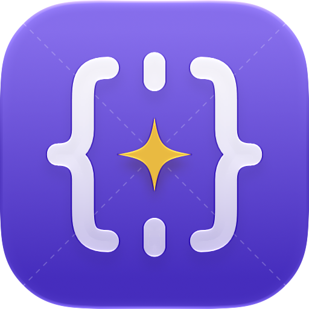
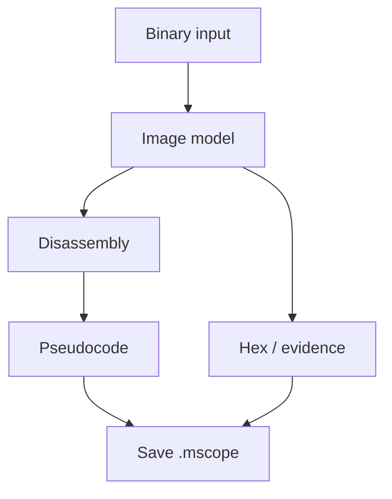

<p align="center">
  <picture>
    <source media="(prefers-color-scheme: dark)" srcset="docs/brand/app-icon-dark.png">
    
  </picture>
</p>

<h1 align="center">MacScope</h1>

<p align="center">
  <strong>Native Apple-silicon binary analysis, from bytes to evidence.</strong>
</p>

MacScope is a locally developed macOS workbench for inspecting
Mach-O binaries, understanding ARM64 code, investigating Swift and
Objective-C metadata, comparing images, and keeping findings in durable
`.mscope` workspaces. Its SwiftUI/AppKit interface coordinates
**Disassembly**, **Pseudocode**, **Graph**, and **Hex** views, with local
debugging and bounded automation alongside static analysis.

The codebase also contains reconstruction, AIRS evidence review,
local-model investigation, bounded native function execution,
captured-app project skeleton export, and security-oriented analysis workflows.
Those surfaces are not blanket claims of runtime availability or
behavioral equivalence: source presence, UI reachability, tests, signed
worker qualification, and installed acceptance are different things.

**[Capabilities](docs/CAPABILITIES.md)** ·
**[Workflows](docs/WORKFLOWS.md)** ·
**[Headless MCP and verification](docs/MCP-AND-VERIFICATION.md)** ·
**[Build and qualification](docs/DEVELOPMENT.md)** ·
**[Evidence status](docs/STATUS.md)** ·
**[Documentation index](docs/README.md)** ·
**[MIT License](LICENSE)**

## Visual workflow

A loaded image anchors the investigation; specialized workers and runtime tools operate behind separate authority boundaries.



## At a glance

| What you can investigate | Tracked MacScope surface |
| --- | --- |
| File and container structure | Mach-O/universal files, bundles, frameworks, dylibs, XPC services, dyld-cache images, plus ELF/PE/COFF static inputs. |
| Native code | ARM64 and x86_64 disassembly, CFGs, cross-references, symbols, strings, imports/exports, relocations, fixups, and address navigation. |
| ARM64 semantics | Signed native SLEIGH pseudocode worker, typed/degraded results, retry/cancel operations, and explicitly attributed MacIR fallback. |
| Language/runtime evidence | Swift metadata and demangling, Objective-C records, dSYM/DWARF, types, C header imports, recovered headers/interfaces, and function signatures. |
| Investigation | Bookmarks, labels, comments, type edits, graph/hex inspection, binary patches, assembler workflows, and export commands. Read-only Apple `.ips` crash-report import correlates UUID-bound frames to loaded functions. |
| Security and compatibility | Code signatures and entitlements, load-path/attack-surface analysis, unwind/Swift error-flow inspection, image comparisons, and AIRS handoffs/bound review. New component-evidence and security-delta implementations remain source-stage until surfaced and qualified. |
| Runtime | Local ARM64 LLDB launch/attach, frames, logical breakpoints, watchpoints, and runtime-to-image correlation. An explicitly confirmed **Run Function** workflow executes selected code in a fresh owned process. |
| Evidence-guided work | Reconstruction corpus/jobs/checkpoints, bounded local assistant tools, REA/AppKit semantic analysis, and captured-app **Xcode skeleton export** (nonfunctional stubs). |
| Integration | JSON batch runner, local MCP/JSON-RPC stdio (binary or saved workspace, explicit slice/journal forms), standard-library Python client, and isolated app-owned shell and plugin boundaries. Headless Verified Analysis commands have distinct journal, live-readback, and saved-package checkpoint tiers. |

Source-backed entry points for these rows appear in
[app commands](MacScope/App/AppCommands.swift),
[product features](MacScope/Features),
[analysis services](MacScope/Services), and the
[capability matrix](docs/CAPABILITIES.md). Availability can depend on
binary architecture, accepted analysis state, installed native resources,
the configured MTPLX model, and local authorization. The comparison and
import workflows do not imply full AIRS integration or automatic trust in
imported reports.

## Scope and limitations

| Area | Present contract |
| --- | --- |
| Host | Apple silicon with **macOS 27.0+**. |
| Developer toolchain | **Xcode 27**, bundled Swift compiler in Swift 6 mode, and bundled LLDB. |
| Static architectures | **ARM64/arm64e** and **x86_64**; ELF/PE/COFF inspection is cross-format, not platform execution. |
| Production pseudocode | **ARM64**. An x86_64 native prototype is staged/disabled, not a production decompiler. |
| Debugger | **Local macOS ARM64** only; even local attach can be denied by code signing, SIP, entitlement, ownership, or target policy. |
| Explicit exclusions | Remote, x86, or Windows debugging; Windows decompilation; AArch32/Thumb, i386, PowerPC, and Hexagon disassembly/analysis. |
| AI | Local **MTPLX** integration under app-owned read/tool authorization. |
| Distribution | The first signed and notarized build is being prepared and will be posted on the repository's [Releases](https://github.com/jdotc1/MacScope/releases) page, free and MIT-licensed. Until then, build from source. |

These are intentional product and platform boundaries, not a claim of
matching any external disassembler/decompiler. See the binding
[capability contract](MacScope/PARITY_CONTRACT.md) and
[evidence status](docs/STATUS.md).
Source files, synthetic fixtures, and past receipts do not establish
current installed or behaviorally equivalent performance.

## Getting started for developers

The first signed and notarized build is being prepared and will be posted on the repository's
[Releases](https://github.com/jdotc1/MacScope/releases) page (free, MIT-licensed). Until then, build
from source. Clone with submodules (`git clone --recurse-submodules`;
`ThirdParty/Lumen` is a submodule). On a prepared Apple-silicon development Mac with the pinned
dependencies and your own local signing identity (see below), run from
the repository root:

```zsh
./Scripts/bootstrap.sh
./Scripts/dev_loop.sh --build-only
```

To iterate on a focused test:

```zsh
./Scripts/dev_loop.sh CoreTests/SomeSuite/someCase
./Scripts/dev_loop.sh Phase2Tests/SomeSuite
```

`Scripts/test.sh` is the explicit test runner and defaults to CoreTests.
`MacScope/project.yml` is the declarative XcodeGen source; the generated
`MacScope/MacScope.xcodeproj` is disposable. Normal bootstrap,
development, and qualification use repository-owned dependency inputs
and verified artifacts in external work roots, without implicit network
dependency resolution.

### Signing identity placeholders

The public tree ships placeholders instead of the author's signing identity.
Before a signed build, set your own values in
[`MacScope/SigningIdentity.xcconfig`](MacScope/SigningIdentity.xcconfig)
(`MACSCOPE_SIGNING_IDENTITY`, `MACSCOPE_SIGNING_TEAM`; defaults are
`Apple Development: Example Developer (CERTID0000)` and `TEAMID0000`).
Hard-coded copies of the same placeholders in the signing-policy checks and
tests (`Scripts/check_local_signing_policy.py` and related tests) must be updated
to match. The unsigned Debug route below needs none of this.

**Build success does not qualify or install a Release candidate.**
`Scripts/qualify_local_private_build.sh` selects a verified canonical
integration ref and runs explicit `prepare`, `smoke`, `focused-test`,
`full-test`, or `release` modes. Installation is separate:
`Scripts/install_local_private_build.sh` has an ordinary verified
Release mode and an explicit
`--mode installed-acceptance` transaction requiring candidate-specific
qualification and predecessor identities. Read
[the full procedure](docs/DEVELOPMENT.md) before using either.

An optional [unsigned Debug route](docs/UNSIGNED_DEVELOPMENT.md)
exists for prepared local iteration; it does not waive the
certificate-backed production or installed acceptance gates.

## Working with the app

- **Open Binary…**, **Open Workspace…**, or **Load Additional Binary…**
  to enter a single- or multi-image investigation. The current image
  and address domain remain explicit.
- Switch between Disassembly, Pseudocode, Graph, and Hex views.
  Search, browse imports/exports/sections, inspect types/debug symbols,
  and request native pseudocode for a supported ARM64 function.
- Compare two loaded images; review optional AIRS handoff and **AIRS Bound
  Review** evidence, security-oriented findings, and unwind/metadata data
  without promoting unresolved or imported claims to truth.
- Open an Apple `.ips` crash report with **File → Open Crash Report…**;
  frames navigate to a function only when binary UUID and address evidence
  resolve unambiguously. See [crash-report import](docs/CrashReportImport.md).
- Save annotations and evidence in `.mscope`. For local runtime questions,
  use the LLDB debugger only with authorized compatible processes.
- Export listings, pseudocode, graphs, types, Swift/Objective-C interfaces,
  and the offered BinExport2 format when the operation is available.
  A separate captured-app AppleScript bridge can export an Xcode skeleton;
  **recovered functions are stubs, not a regenerated working application**.
  Output correctness remains input- and gate-specific.

**Run Function executes code**, including loader initialization and constructors,
inside a fresh owned process. Use only authorized, appropriately trusted inputs;
see [native execution safety](docs/NATIVE-FUNCTION-EXECUTION.md). The
[regeneration guide](docs/REGENERATION-USAGE.md) explains the limited
captured-app Xcode export. The [workflow guide](docs/WORKFLOWS.md)
covers the other paths and caveats.

### Headless integration

The built executable accepts a JSON batch script or a local MCP server
for a binary or an existing `.mscope` workspace:

~~~zsh
/path/to/MacScope.app/Contents/MacOS/MacScope --run-script /path/to/script.json /path/to/binary
/path/to/MacScope.app/Contents/MacOS/MacScope --mcp /path/to/binary
/path/to/MacScope.app/Contents/MacOS/MacScope --mcp /path/to/workspace.mscope
/path/to/MacScope.app/Contents/MacOS/MacScope --mcp /path/to/fat-binary --slice arm64
/path/to/MacScope.app/Contents/MacOS/MacScope --mcp /path/to/workspace.mscope --journal /path/to/edits.journal
~~~

The dependency-free [Python client](MacScope/python/README.md) wraps the
base `--mcp <path>` invocation and MCP/JSON-RPC over stdio; it does not expose
the optional slice or journal flags in its current `open()` API. Headless
edits are not automatically persisted as a saved workspace. An explicit
journal supports replay, while the new `verified-commit` path requires it
and still reports journal durability rather than saved-package readback.
The `MACSCOPE_MCP_LIST_PROFILE` setting controls only which tools are
advertised (`core` by default, `full` on request), not command authority.
See [Headless MCP and verification](docs/MCP-AND-VERIFICATION.md) for
option order, command gates, verified checkpoints, and recovery semantics.
These local commands do not grant shell, debugger, or target-execution
authority to the analyzed binary.

### Native pseudocode policy

The native decompiler is enabled by default at process startup. The
`MACSCOPE_NATIVE_DECOMPILER_ENABLED` environment key overrides the
`nativeDecompiler.enabled` Boolean in the
`com.jeff.machscope` defaults domain. Trimmed, lowercased
`1/true/yes/on` enable; `0/false/no/off` disable.
Unrecognized environment values fall back to enabled. Fully quit and
relaunch after a change. Operational metadata can be inspected with:

```zsh
log stream --style compact \
  --predicate 'subsystem == "com.jeffcooney.MacScope" AND category == "NativeDecompiler"'
```

Native worker readiness and validation still govern individual results.
A MacIR fallback must remain clearly attributed as such.

## Architecture and trust

The app owns image/session identity, commands, authorization, accepted
evidence, durable workspace state, and presentation. Isolated workers
return bounded proposals or results; they do not inherit full app
authority. The tracked services include:

| Boundary | Role |
| --- | --- |
| [Analysis Worker](MacScope/AnalysisWorkerService) | Parsing, analysis, metadata, and selected resource-bounded inspection. |
| [Native Decompiler XPC](MacScope/NativeDecompilerXPCService) | SLEIGH-backed ARM64 pseudocode and typed, transient validated output. |
| [AI Agent Worker](MacScope/AIAgentWorkerService) | MTPLX-oriented bounded local inference under app authorization. |
| [ShellBroker](MacScope/ShellBrokerService) | Controlled local processes, PTYs, and terminal resources. |
| [LLDB services](MacScope/Services/Debugger) | Local ARM64 debugger transport/session control. |

Runtime observations, model proposals, imported AIRS evidence, verified
annotation receipts, saved-package checkpoints, worker metadata, and binary
bytes have different provenance. Missing or
malformed evidence remains missing/degraded; it must not be silently
upgraded to certainty. See the
[capability contract](MacScope/PARITY_CONTRACT.md) and
[developer guide](docs/DEVELOPMENT.md).

## Source, dependencies, and rights

The tracked tree contains the application and worker sources,
[project definition](MacScope/project.yml), local scripts, golden fixtures,
and reviewed third-party inputs. Source and license identities are
recorded in [THIRD_PARTY_COMPONENTS.yml](THIRD_PARTY_COMPONENTS.yml),
[THIRD_PARTY_NOTICES.md](THIRD_PARTY_NOTICES.md), the
[first-party pin](FIRST_PARTY_COMPONENTS.json), and
[dependency workflow](docs/dependencies/DependencyWorkflow.md).
Generated products, caches, signed bundles, and local
installation receipts do not belong in Git.

Copyright (c) 2026 Jeffrey Cooney. Original MacScope source code,
documentation, and project-owned assets are licensed under the
[MIT License](LICENSE), unless another license or copyright notice applies.
Third-party components and source-derived materials retain their own terms;
see [THIRD_PARTY_NOTICES.md](THIRD_PARTY_NOTICES.md).

For how to read status claims, see [STATUS.md](docs/STATUS.md).
